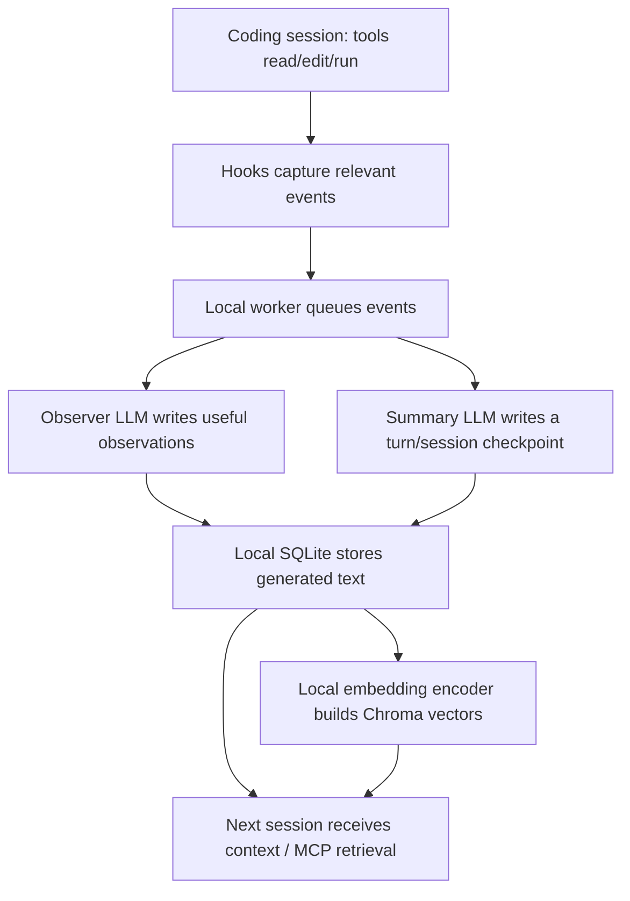

# Original Claude-Mem versus cmem-light: observer, auth and local embeddings

2026-11-12. Explanation/source review only. Fork inspected at
`0e268712a235881d5c1dadfe60df6c2238473014`, `feat/cmem-light-local`.
Local retained initial snapshot: `f6df542326fccaa9717d13617ff9b30405c486b2`.
This root snapshot has no parent here; do not cite an unavailable parent as
the original source. Public upstream README v15.5.0 and current main/docs were
also consulted. Current main/docs are moving sources, not an exact pinned diff.

## The important correction

The original already sends separate generative observer requests to turn
tool activity into observations and session summaries. The fork did not invent
that requirement. A separate observer role/request does not require a different
model, provider, account or subscription. The owner's existing Bedrock route
may be explicitly selected for it, subject to target support/permission checks.
One default profile can cover observation and summary; overrides are optional.

The earlier phrase "another model" was ambiguous: the additional operation is
a generative request, which may use the same model as the coding session.
Local MiniLM performs vector encoding for retrieval; it does not write prose.
The owner has not yet selected a live worker profile/model/budget.

## Upstream findings and boundaries

- The retained baseline settings have provider `claude`, auth `subscription`
  and model `claude-haiku-4-5-20251001`. Current upstream configuration documents
  `claude`/`subscription` with model alias `haiku`. The main coding session may
  use a different model; note-taking is a separate SDK request.
- Current upstream README and README v15.5.0 describe an installer offering
  the hosted CMEM observer and own-provider/Anthropic-plan options. Therefore
  "all original installations always use your subscription" is inaccurate:
  effective routing depends on installation choices and saved configuration.
- Upstream supports disabling observation hooks and the end-of-turn summary.
  That removes new automatic AI-generated notes, not the need for generation
  when requesting those notes. Reading previously stored notes is a different
  operation. No model-free daily-use mode was implemented/validated here.
- Subscription mode's account quota and Bedrock/AWS billing/auth are different
  routes. Existing SSO for the development CLI does not demonstrate the worker
  can invoke its selected Bedrock model under the required target environment.

Primary references, consulted 2026-11-12:
[configuration](https://docs.claude-mem.ai/configuration#core-settings),
[upstream architecture](https://docs.claude-mem.ai/architecture/overview),
[README v15.5.0](https://github.com/thedotmack/claude-mem/blob/v15.5.0/README.md),
[current README](https://github.com/thedotmack/claude-mem#quick-start),
[current observer SDK implementation](https://github.com/thedotmack/claude-mem/blob/main/src/services/worker/ClaudeProvider.ts),
[current auth implementation](https://github.com/thedotmack/claude-mem/blob/main/src/shared/EnvManager.ts).
No pricing amounts, exact subscription allowance or target live support were
verified. No upstream install/signup/model call was executed.

## What the fork actually changed

Static source citations at inspected fork SHA above:

| Path/line | Behavior |
|---|---|
| `src/services/worker/model-profiles.ts:150,158` | Missing explicit model profile resolves to `paused/profile_required`; ordinary roles inherit the selected default. |
| `src/services/worker/MainWorkerProfiles.ts:109,124` | Explicit Claude profile prepares selected API-key/login/AWS-SSO auth; no implicit discovery of a different provider. |
| `src/services/worker/MainWorkerProfiles.ts:204` | Starting observer generation requires configured observer selection. |
| `src/services/worker/http/routes/SessionRoutes.ts:227,235` | Main-worker route records setup-required/paused when profile is absent; it does not silently use legacy defaults. |
| `scripts/enterprise-local/codex-local.mjs:507,509` | Private `start` requires `--profile`; this launcher cannot be described as a ready no-profile search-only mode. |
| `docs/enterprise-local/LLM-PROFILES.md` | One explicit default and optional overrides; local persistence/index and selected external inference remain separate. |

This is a real configuration/admission change from upstream defaults, accepted
under A19/A27 and later profile slices. It prevents accidental account/model/
gateway fallback. It does not demand a second subscription or a second locally
downloaded generative model. Choosing the same model/account for coding and
note-taking is compatible with the design; its actual Bedrock operation is
still NOT RUN on the target.

## Conceptual sequence

Observer and summary boxes can use one model/profile. In the fork, local
MiniLM is the selected embedding encoder. The generative worker test fixture
used deterministic loopback responses while real local SQLite/Chroma/MiniLM
were exercised in the previously recorded checks. Fake responses do not
certify a live account/model or useful real-world summarization quality.

## What remains to decide and test

The practical choice is which approved model/auth route may generate memory
notes in daily use, not whether to buy a mandatory additional model. The owner
may choose their existing Bedrock/SSO account and one available model; a small
synthetic test needs exact model/profile/region/payload/budget first. After
configuration, ordinary generation should be automatic under that persistent
selection, not a new user prompt for each note. No live choice or test is
authorized merely by this explanatory question. Preserve the existing
step-11 host/fake-worker check before separately scoped live acceptance.
