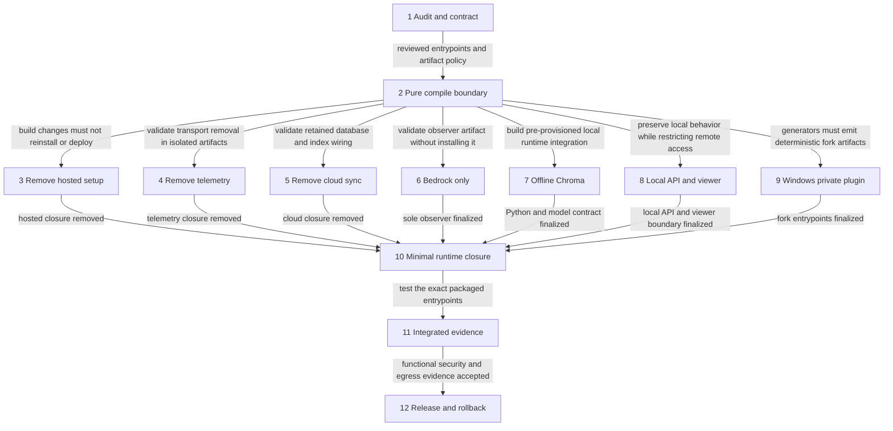

# Enterprise local memory roadmap

This is an ordered decomposition, not a calendar commitment. Implementation is not
authorized by this document. Review the current [handoff](enterprise-local/memory/STATE.md).

## Destination

A private Windows Claude Code plugin preserves existing memory and local viewer behavior
through local SQLite/FTS5 and offline persistent Chroma, uses only approved
Bedrock inference, and installs reversibly from a verified local bundle with evidence
of no unapproved runtime egress in the tested scenarios.

## Steps

Sizes are provisional scope bands, not approved PR counts or schedules. `idea` means
implementation has not begun; static reconnaissance is recorded separately in STATE.
Source abbreviations below: IP = [preserved initial plan](enterprise-local/source/INITIAL-PLAN.md).

Current prerequisite evidence: user-installed dependencies, successful existing upstream
build and worker ready output on Node 22.23.4/npm 10.9.9/Bun 1.4.4; see
[DEV-ENVIRONMENT](enterprise-local/DEV-ENVIRONMENT.md). Session 02 pure compile and
6+21 focused checks passed; policy/offline/provenance acceptance remains pending
([BUILD-02](enterprise-local/handoffs/BUILD-02.md)). Active execution ownership
is in [TASKS](enterprise-local/memory/TASKS.md); no dependency edges/waves changed.

| # | Step | Source | Size | Status |
|---|---|---|:---:|---|
| 1 | Close static audit and agree runtime/artifact contract | IP §6 P0/P1; §10; [inventory](EGRESS-INVENTORY.md) | S | idea |
| 2 | Compile locally without install, marketplace sync or restart | IP §5.8 W8; [baseline](BASELINE.md#build-and-supply-chain-findings) | S | in progress; compile/checks pass, lifecycle-policy/offline/provenance gates open |
| 3 | Local memory works without hosted setup/history import | IP §5.1 W1 | S | idea |
| 4 | Local diagnostics work without remote telemetry | IP §5.2 W2 | S | idea |
| 5 | Local SQLite/Chroma works without cloud sync | IP §5.3 W3 | S | idea |
| 6 | Observer uses only validated corporate Bedrock | IP §5.4 W4 | M | idea |
| 7 | Chroma starts and retrieves from pre-provisioned local assets | IP §5.5 W5 | M | idea |
| 8 | Local API/viewer rejects remote access while existing memory behavior is preserved | IP §5.7 W7, narrowed by [A06/A07](enterprise-local/memory/DECISIONS.md) | S | idea |
| 9 | Private plugin loads through deterministic Windows-local paths | IP §5.6 W6 | M | idea |
| 10 | Minimal artifact contains only the approved runtime closure | IP §5.8 W8; §6 P2/P5 | S | idea |
| 11 | Integrated memory passes offline and approved Bedrock acceptance | IP §6 P6/P7; §7 | M | idea |
| 12 | Verified Windows bundle, SBOM, install and rollback are ready | IP §6 P8; §13 | S | idea |

## Not yet specified

No undefined product area is being assigned speculative tickets. Concrete unanswered
questions are below; resolving them may change sizing, tasks or waves. Python/model
selection is a research task with known constraints, not permission to download.

## Out of scope

- Shared internet-facing memory service, multi-user server and non-Claude harnesses —
  outside the retained product boundary (IP §0.3).
- Rewriting the observer SDK or database without a verified need — unnecessary fork size.
- Automatic historical-memory migration — fresh isolated data first.
- Changing managed AWS/plugin/network policy — requires the approved enterprise workflow.
- Fully offline LLM inference — the requested observer uses approved Bedrock traffic.
- Rewriting project/worktree identity, sharing, query-scope defaults or capture/retrieval
  semantics — explicitly deferred by the user, including existing separation weaknesses.
- A new capture/DLP subsystem — review current behavior and payload policy first;
  separately scope any policy-required functional change rather than silently adding it.

## Open decisions

| # | Question | Type | Owner | Blocks |
|---|---|---|---|---|
| D1 | Which artifact mirror/source and lifecycle execution are approved? | grilling | human | 2, 7, 12 |
| D2 | What capture content may persist locally and reach Bedrock? | grilling | human | 8, 11 |
| D5 | Is private plugin loading allowed and how is upstream disabled in a test session? | grilling | human | 9, 11 |
| D7 | Approved AWS Region/model or inference profile and profile conventions? No secrets. | grilling | human | 6, 11 |
| D8 | Approved local data location, retention and backup rules? | grilling | human | 8, 12 |
| D9 | Exact Python/ONNX model/dependency hashes, licenses and supported offline API? | research | agent | 7, 12 |
| D10 | Remaining dynamic clients, custom providers, connectors, UI assets and routes? | research | agent | 1, 10 |
| D11 | May missing Chroma enter explicitly visible SQLite-only degraded mode? | grilling | human | 7, 11 |

These questions do not block the current documentation. Ask each policy question when
its dependent implementation is next, rather than requiring a large interview now.

## Decisions so far

- Use the selected branch and tracked repo documentation → [A01/A02](enterprise-local/memory/DECISIONS.md).
- Historical docs-only restriction A03; bounded Session 02 source/compile/check permission
  and implemented boundary A10/A11 → [decisions](enterprise-local/memory/DECISIONS.md).
- Separate source evidence from requirements/hypotheses → [A04](enterprise-local/memory/DECISIONS.md).
- Retain local viewer and upstream memory scope behavior; project/worktree redesign
  deferred → [A06/A07](enterprise-local/memory/DECISIONS.md). This closes former D3/D4/D6
  for this release; default behavior is preserved rather than asserted to provide isolation.
- Preserve local core; proposed implementation refinements → [architecture](ARCHITECTURE-LOCAL.md#changes-to-the-supplied-plan).

## Dependency graph

This graph is the single source of task dependencies. Wave ordering below additionally
serializes shared-file integration; a later wave does not imply a hidden dependency.
External authorization and policy gates live in Open decisions and the current handoff.

## Execution path

Parallel lanes are opportunities, not work started now. Current user preference is one
branch; implement serially there by default. Truly concurrent code work needs separately
owned files/checkouts and explicit coordination. Shared worker/settings edits are always
serialized; do not launch overlapping agents directly on this checkout.

| Wave | Steps | Zone per step (why parallel-safe) | Unlocks |
|:---:|---|---|---|
| 1 | 1 | `docs/`; read-only full-source audit | Agreed evidence and policy contract |
| 2 | 2 | `scripts/`, `package.json`; isolated build entrypoint (new) | Safe future compile workflow |
| 3 | 3 ∥ 7 | 3: hosted setup/work-view routes and UI; 7: `src/services/sync/ChromaMcpManager.ts`, `ChromaSync.ts`, offline Python adapter (new). Reserve shared settings/worker integration for a single owner. | Hosted-free surface and local vector candidate |
| 4 | 4 ∥ 9 | 4: `src/services/telemetry/` and worker telemetry hooks; 9: `src/launcher/`, `plugin/hooks/`, `plugin/.mcp.json`, hook generators, PowerShell installer (new). Serialize any shared manifest edit. | Telemetry-free runtime and deterministic launch candidate |
| 5 | 5 | `DatabaseManager.ts`, `CloudSync.ts`, `SyncClient.ts`, cloud routes; exclusive worker/settings wiring | Retained local index without remote sync |
| 6 | 6 | `ClaudeProvider.ts`, `provider-dispatch.ts`, `EnvManager.ts`, sanitizer, SDK options; exclusive dispatch/settings integration | Bedrock-only candidate, synthetic/mock validation only |
| 7 | 8 | Worker HTTP, viewer assets/config and tests; preserve `src/utils/` identity and existing storage/query/capture semantics | Local-only API/viewer candidate with memory regression coverage |
| 8 | 10 | `scripts/build-hooks.js`, manifests/locks and `plugin/scripts/`, `plugin/ui/`; one integration owner | Reviewed artifact for acceptance |
| 9 | 11 | `tests/`, fresh disposable data (new), approved network evidence (new) | Accepted tested artifact |
| 10 | 12 | Distribution bundle (new), PowerShell installation/docs/SBOM (new); rerun install acceptance on final hashes | Release candidate |

Zones are grounded in this reconnaissance rather than a complete architecture survey;
re-cut lane ownership after step 1 and whenever shared-file scope changes.

## Shipped

No implementation step shipped. Documentation progress is in
[WORKLOG.md](enterprise-local/memory/WORKLOG.md).
